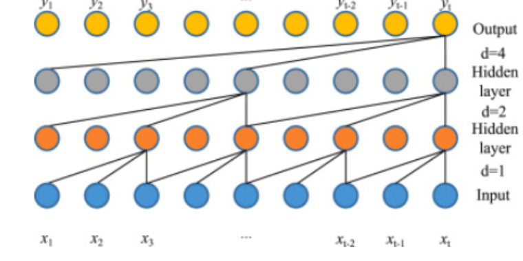

# TCN-Attention Time Convergence Fusion Attention Mechanism Prediction 24 Steps Ahead Matlab Program

The TCN-Attention multivariate time series regression prediction algorithm, based on temporal convolution and attention mechanism for multivariate regression prediction. MATLAB program, the TCN-Attention multivariate feature input with single sequence variable output, provides training feature maps for a certain layer, realizes feature visualization, inputs the features of the previous day to achieve predictions for the next day, and provides predictive steps ahead by 24 steps. It is suitable for wind speed prediction, photovoltaic power prediction, power generation prediction, offshore wind power prediction, carbon price prediction, etc.

Platform: MATLAB 2023 version or above

Data can be read from an Excel file directly and replaced into the program without needing significant modifications to the program. The program includes detailed comments for easy understanding of the program's operation.

## Images

<!-- PAYMENT_BLOCK -->

## Get this dataset

- Payment link (Stripe): [Buy now](https://buy.stripe.com/3cs8yP7sY87d0vu9AB)
- Payment QR code: 

<!-- /PAYMENT_BLOCK -->
